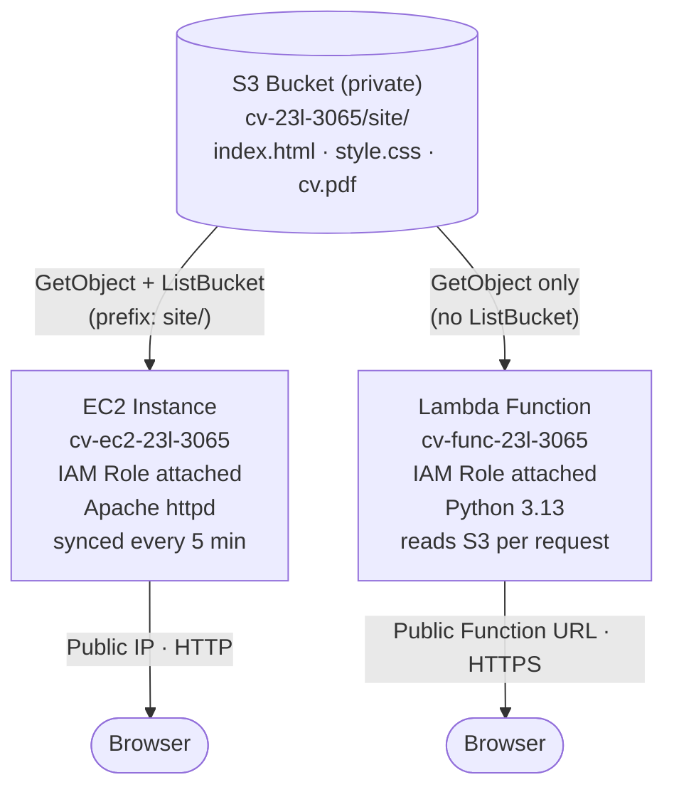
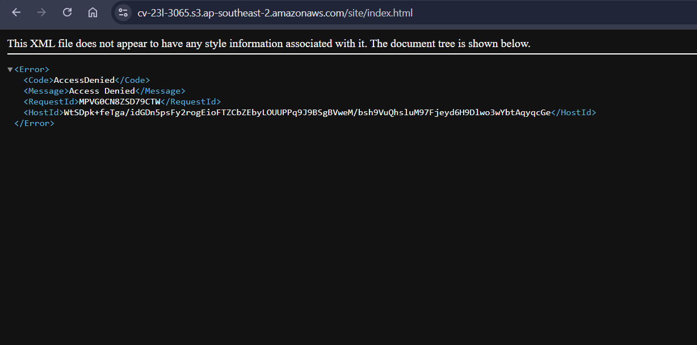
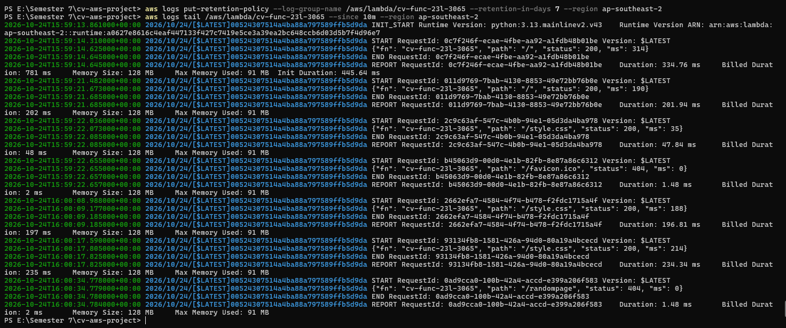
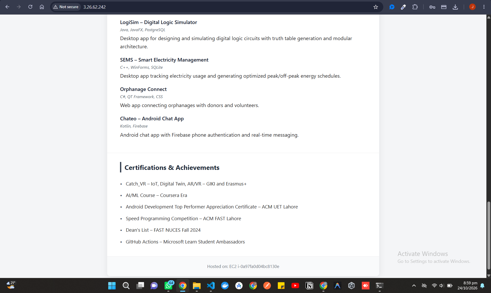
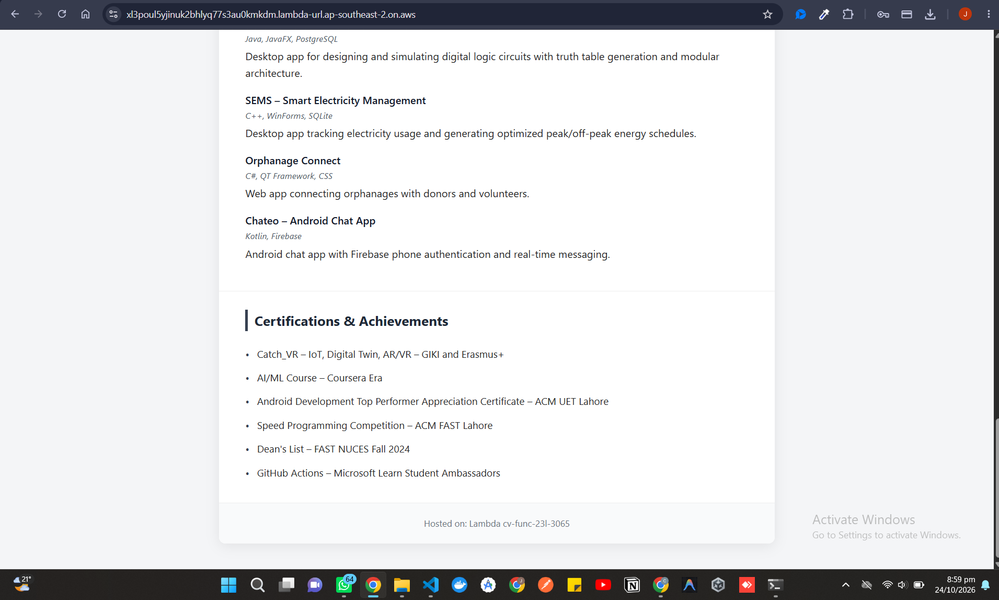
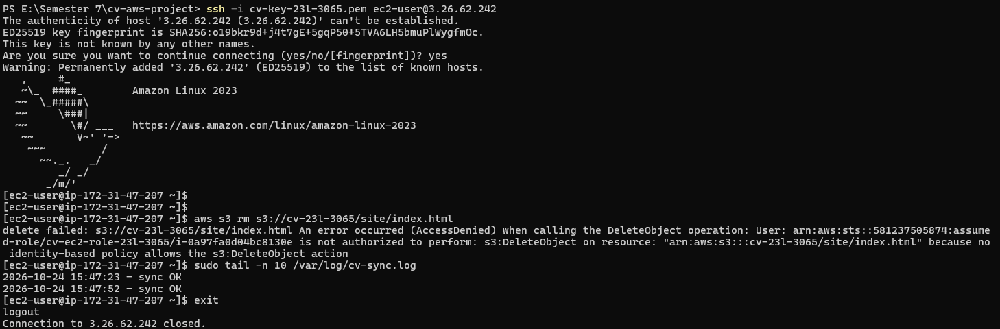
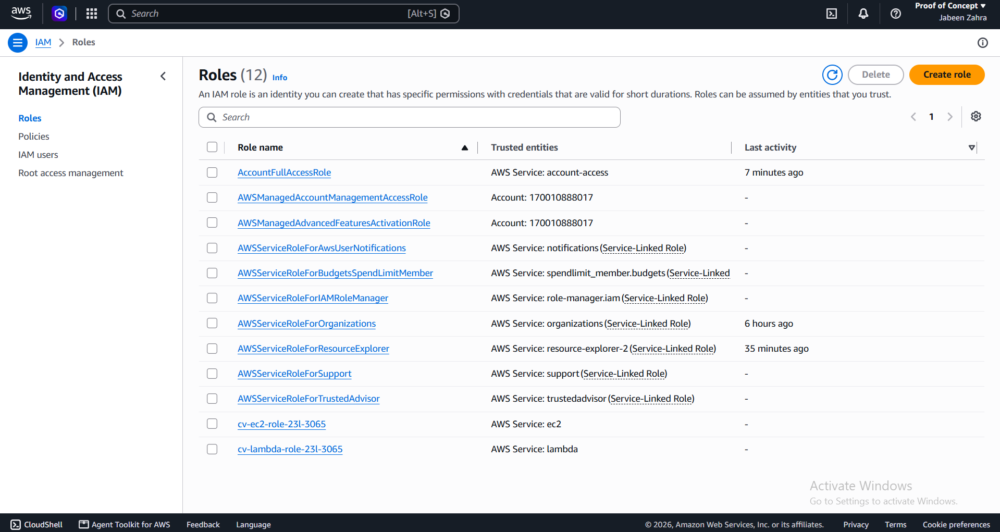

<div align="center">

# Host Your CV on AWS

### 23L-3065 · Jabeen Zahra

[](https://aws.amazon.com)
[](https://aws.amazon.com/ec2/)
[](https://aws.amazon.com/lambda/)
[](https://aws.amazon.com/s3/)
[](https://aws.amazon.com/iam/)

[]()
[]()
[]()
[]()

BS Software Engineering · FAST NUCES Lahore

</div>

A CV served two ways from one private S3 bucket — once by an **EC2** web server, once by a **Lambda** function — with IAM roles doing all the authorization work.

---

## Live Endpoints

<div align="center">

[](http://3.26.62.242/)
[](https://xl3poul5yjinuk2bhlyq77s3au0kmkdm.lambda-url.ap-southeast-2.on.aws/)

</div>

| Path | URL |
|---|---|
| **EC2** | http://3.26.62.242/ |
| **Lambda** | https://xl3poul5yjinuk2bhlyq77s3au0kmkdm.lambda-url.ap-southeast-2.on.aws/ |

---

## Architecture




**EC2 path:** A browser request hits the instance's public IP on port 80. Apache serves static files that a systemd timer syncs from the private S3 bucket every 5 minutes, using the EC2 IAM role.

**Lambda path:** A browser request hits the public Function URL, invoking the function. The function reads the requested object straight from S3 on every call, using the Lambda IAM role, and returns it with the correct content type.

---

## Evidence


<details>
<summary><strong>Access Denied Proof (Section 4)</strong></summary>

Attempted from inside the EC2 instance via SSH, using the attached IAM role — not the admin user. The role only grants `s3:GetObject` and `s3:ListBucket` (with a `site/` prefix condition), so a delete attempt is rejected.



</details>

<details>
<summary><strong>/var/log/cv-sync.log — last 10 lines</strong></summary>

The systemd timer fires every 5 minutes and every run has succeeded.



</details>

<details>
<summary><strong>EC2 site loading</strong></summary>



</details>

<details>
<summary><strong>Lambda site loading</strong></summary>



</details>

<details>
<summary><strong>Direct S3 access denied</strong></summary>



</details>

<details>
<summary><strong>IAM roles</strong></summary>



</details>

---

## Written Answers


<table>
<tr><td>

**1. Why roles instead of access keys? What could go wrong with keys in user data?**

Roles hand out short-lived, auto-rotated credentials scoped exactly to the attached policy, with no secret ever stored anywhere. If long-lived access keys were placed in the user data instead, anyone with read access to the instance metadata, the EC2 console, or a copy of the script could extract and reuse those keys indefinitely — even after the instance is gone. They could also leak into logs, AMIs, or snapshots. Roles remove the secret entirely, so there's nothing to steal.

</td></tr>
<tr><td>

**2. Someone pastes the S3 address of index.html into a browser. What do they see, and which setting causes that?**

They see an Access Denied (403) error instead of the page. This is caused by the bucket's four Block Public Access settings being enabled, combined with having no bucket policy or ACL that grants public read — so only the two IAM roles can ever read the objects.

</td></tr>
<tr><td>

**3. Explain the function URL permission that lets anyone call it. Why is that acceptable for the function but not for the bucket?**

The function carries a resource-based policy allowing principal `*` to invoke it via `lambda:InvokeFunctionUrl` / `lambda:InvokeFunction`, scoped to this one function only. This is safe because the function can only ever return the three static files it already has read access to — no write, no delete, no raw storage exposure. Making the S3 bucket itself public would hand out unrestricted storage access with no logic controlling what's read, written, or deleted, and no per-request logging.

</td></tr>
<tr><td>

**4. Compare the two paths. What do you pay for when nobody visits? What happens at 100x traffic?**

EC2 bills for the running t3.micro every hour regardless of traffic. Lambda bills only per invocation and per millisecond of execution, so zero traffic costs next to nothing. At 100x traffic, the single EC2 instance would need manual resizing or a load balancer with auto scaling, while Lambda scales automatically with no intervention required, up to account concurrency limits.

</td></tr>
<tr><td>

**5. You delete the EC2 instance. What do you lose and what do you still have?**

You lose the running web server and its public IP — the EC2 path goes down entirely. You keep the S3 bucket and all three files, the Lambda function and its URL, both IAM roles, and the security group. The Lambda path is completely unaffected, and a new EC2 instance could be relaunched from the same role, security group, and user-data script to restore the EC2 path.

</td></tr>
</table>

---

## Repository Layout


```
README.md
collect-evidence.sh
evidence.txt
site/            index.html, style.css, cv.pdf
ec2/             user-data.sh, sync-cv.sh
lambda/          lambda_function.py
iam/             ec2-trust-policy.json, ec2-permission-policy.json,
                 lambda-trust-policy.json, lambda-permission-policy.json
screenshots/     access-denied.png, sync-log.png, ec2-site.png,
                 lambda-site.png, s3-direct-denied.png, iam-roles.png
```

Region used throughout: `ap-southeast-2` (Sydney)